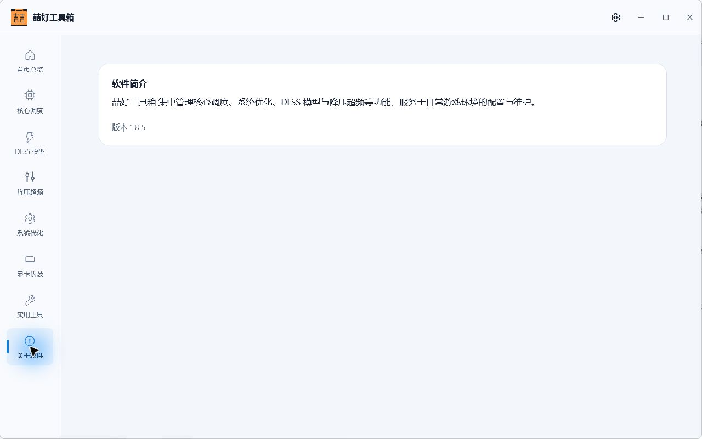

# 喆好工具箱

Windows 游戏环境配置与维护工具，集中管理核心调度、系统优化、DLSS 模型与降压超频等功能。当前版本：**1.8.6**。

## 下载与使用

[下载最新版本](https://github.com/suli9710/zhehao-toolkit/releases/latest)

下载 Release 中的 `Zhehao.Toolkit.v1.8.6.exe` 即可运行，也可改名为 `喆好工具箱.exe`。支持 Windows 10 / 11 x64，单文件包自带 .NET 10 运行时、功能模块和更新运行库。按程序提示授予管理员权限。

替换旧版时，先从托盘正常退出旧进程，再运行新版。



## 在线更新

设置中保持“自动检查更新”开启。程序连接本仓库的 GitHub Releases，发现新版后自动下载，下载完成后可重启安装。更新页也支持手动检查。

检查入口为 GitHub 公开签名清单下载地址，可避免共享 IP 的匿名 API 限流。更新清单采用 RSA-PSS / SHA-256 签名，程序内置公钥并核对下载地址、产品、版本、文件长度和 EXE 哈希。保留原有退出准备、文件锁、更新事务与失败回滚流程。普通用户无需配置 GitHub 账号、Token 或额外运行环境；在线更新需要能够访问 GitHub。

## v1.8.6 变更

- 关于页仅保留软件简介和版本号，导航描述更新为“简介与版本”。
- 主窗口、托盘、程序图标、产品信息使用“喆好工具箱”品牌。
- 在线更新使用本仓库发布的签名版本并自动下载。
- 内置 PBO 启动路径修复：使用 Windows 文件句柄取得 EXE 真实路径，兼容中文、空格、长路径及迁移后的目录联接。原有路径、权限与文件保护继续生效。

[版本说明](docs/releases/v1.8.6.md)

## 验证范围

构建时验证：

- 包内 **466 个依赖与功能资源文件**与原版逐字节一致。
- 修改后的主程序集、9 个 Windows 图标资源、产品信息及正式版管理员运行清单有效。
- 正式版主程序集通过隔离启动检查，退出码为 **0**。
- 关于页内容与内置更新运行库正确。
- PBO 只读路径验证通过，23 个原保护方法保持一致，硬链接仍被拒绝。
- RSA 签名、GitHub 资产绑定、版本检查及篡改清单/EXE 拒绝检查通过。

本次未执行硬件超频、降压、驱动写入或实际重启安装测试。详细验证结果保存在本地发布目录的 `验证报告.json` 和 `喆好工具箱.build.json`。

## 构建

需要 Windows x64、PowerShell 7.6（.NET 10）和 Python 3.12 或更新版本。

```powershell
python -m pip install -r requirements.txt
pwsh -NoProfile -File scripts/build.ps1 -VerifyStartup -OutputDirectory dist/v1.8.6
```

脚本自动下载并校验上游 v1.8.4 发布包，生成图标，修改主程序集与 WPF 资源，内嵌更新运行库，再重新封装为单文件 EXE。原包保持不变，临时材料及验证文件写入 `inspection/`、`build/` 和 `dist/`。

原包 SHA-256：`b784c1c024d0eee3b570b0471f91b13b516858fcd14921292c5c0d0c1fffa18d`

## 发布与签名密钥

维护者更新 `release.json` 的版本及对应版本说明，使用现有私钥构建、签名并验证，然后提交并推送代码：

```powershell
pwsh -NoProfile -File scripts/build.ps1 -VerifyStartup -SignRelease -OutputDirectory dist/v1.8.6
git add .
git commit -m "Release v1.8.6"
git push origin HEAD:main
pwsh -NoProfile -File scripts/publish-release.ps1 -OutputDirectory dist/v1.8.6
pwsh -NoProfile -File scripts/verify-update.ps1 -OutputDirectory dist/v1.8.6 -LiveGitHub
```

发布脚本先创建草稿，上传 EXE、签名清单与校验文件，核对 GitHub 资产长度及摘要后公开发布。已公开版本不允许覆盖，修改发布内容时应增加版本号。

私钥保存在仓库外的 `%LOCALAPPDATA%\ZhehaoToolkitRelease\update-signing-key.pem`，不会上传到 GitHub。**后续版本必须使用同一私钥**，以便已发布 EXE 中的公钥继续验证更新。维护者需自行备份私钥；普通用户无需持有它。

`initialize-signing-key.ps1` 仅用于建立新的独立发行渠道；已有发行配置或密钥时会拒绝执行，不应在现有更新渠道中重复运行。

## 文件结构

```text
assets/       原创 SVG 标识、关于页 XAML 与界面截图
scripts/      下载、修改、封装、签名、验证与发布脚本
docs/         版本说明与上游检查记录
release.json  版本、更新仓库与签名公钥
inspection/   原始发布包与构建依赖（不提交）
build/        中间程序集与隔离验证包（不提交）
dist/         单文件 EXE 与签名清单（通过 Releases 发布）
```

项目及第三方组件来源见 [NOTICE.md](NOTICE.md)。本仓库包含定制脚本与新增代码，不包含上游未公开的完整程序源码。
